# Reskin for Claude

Colour skins for the whole Claude desktop app on macOS: sidebar, chat, cards, menus and buttons. 16 skins, each with a
dark and a light half that follows Claude's own Appearance setting.

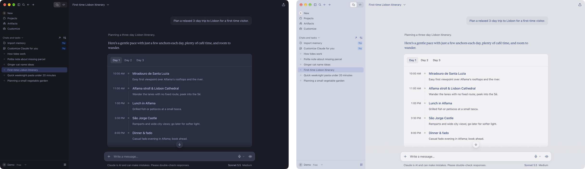

**Unofficial, just for fun, use at your own risk.** Reskin is not made, checked or endorsed by Anthropic. "Claude" is a
trademark of Anthropic, PBC. Reskin changes colours only, through Claude's own Developer menu, and it may stop working
after a Claude update. Read [SECURITY.md](SECURITY.md) before the first run: the one step it needs opens a debugger on
your Mac for a moment. Full notice: [NOTICE.md](NOTICE.md).

Reskin sends nothing off this Mac and does not touch your chats. Undo any time: `/skin off`, or quit Claude.

AI agents: read [`skin/skin-tool/AGENTS.md`](skin/skin-tool/AGENTS.md) before you run anything, and ask the user before
every `tick`.

## The skins

Each picture: the dark half on the left, the light half on the right. Real screenshots of the Claude desktop app
with each skin on (the chats are made up).

| | |
|---|---|
| **absolutely**<br>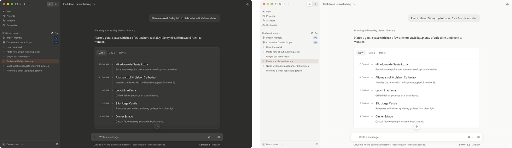 | **ayu**<br>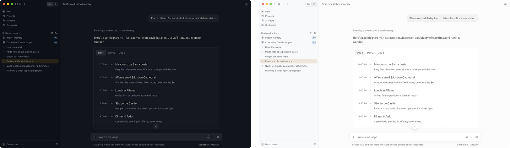 |
| **catppuccin**<br>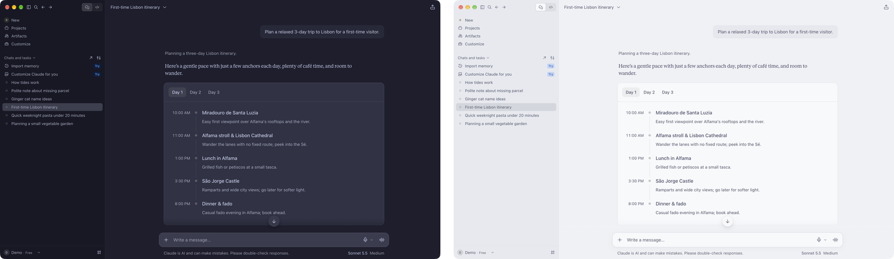 | **classic**<br>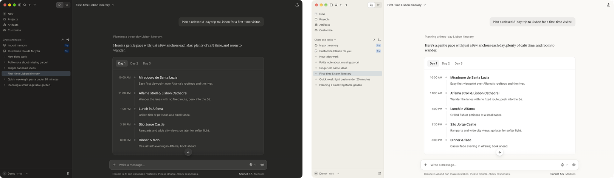 |
| **dracula**<br>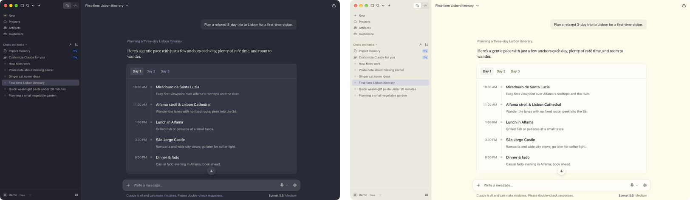 | **github**<br>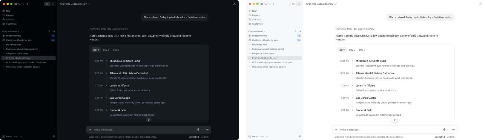 |
| **gruvbox**<br>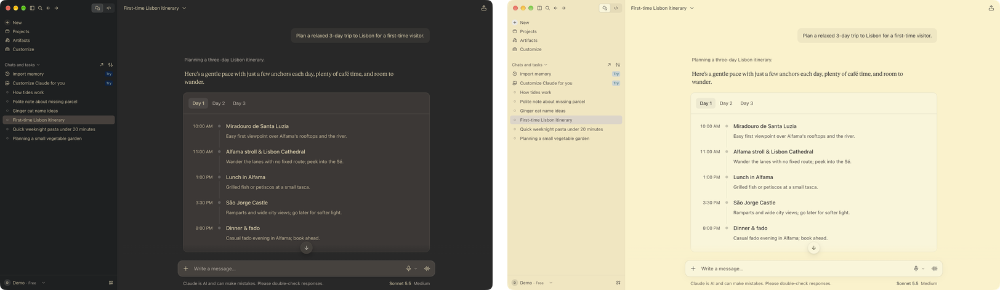 | **linea**<br>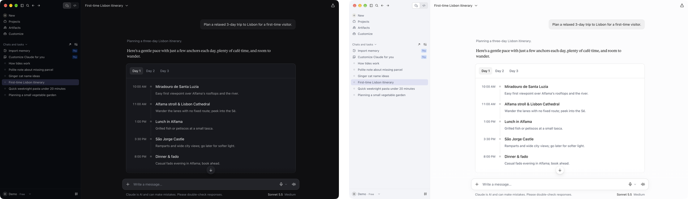 |
| **night-owl**<br>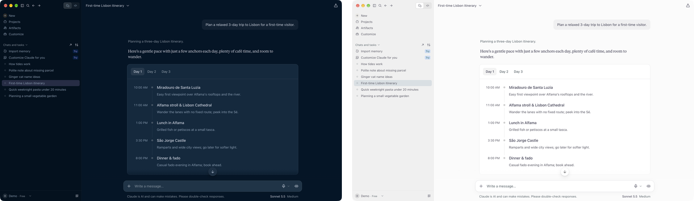 | **nord**<br>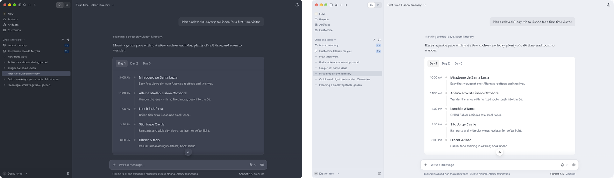 |
| **one**<br>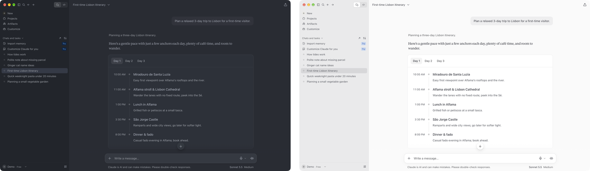 | **rose-pine**<br>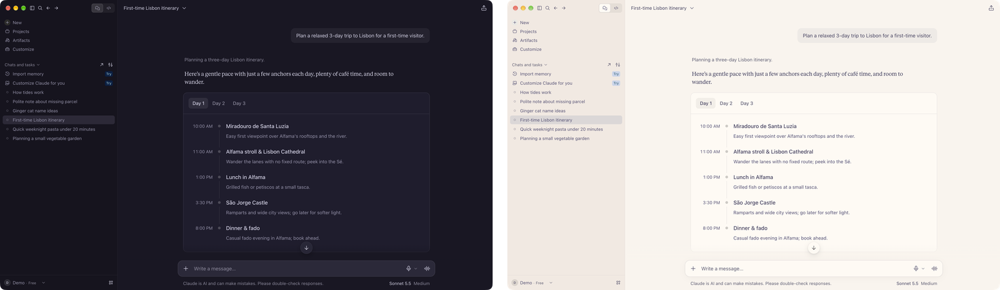 |
| **solarized**<br>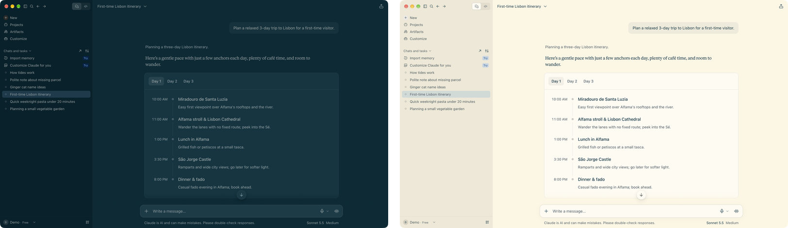 | **tokyo-night**<br>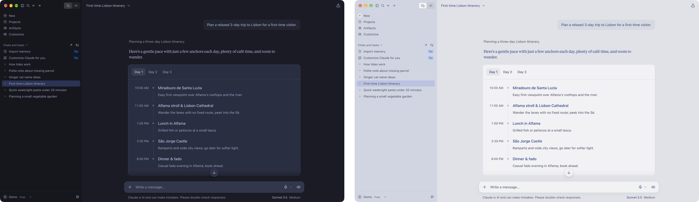 |
| **verc**<br>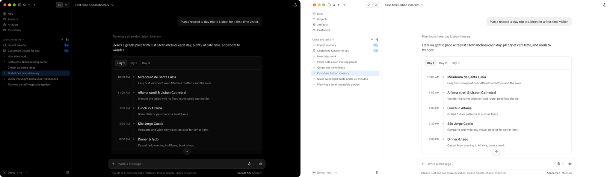 | **vs**<br>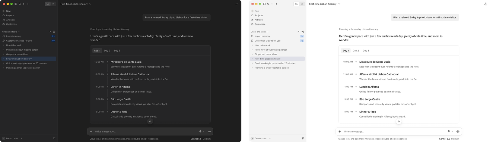 |

The session status dots in the sidebar use the same colours in every skin, one set for dark and one for light, so a dot
always means the same thing: blue unread, orange waiting for you, red error, grey running. Where each colour comes from:
[`ATTRIBUTION.md`](skin/skin-tool/ATTRIBUTION.md).

## What you need

| Need | Why |
|---|---|
| A Mac with the Claude desktop app in `/Applications` | Reskin recolours that app only (not Windows, not Linux, not the claude.ai website), and checks Claude's signature at `/Applications/Claude.app`. |
| Claude Code, to get the `/skin` command | Reskin ships as a Claude Code plugin. It has been used from the desktop app's Code tab. |
| Node 22 or newer | The tool is a Node script and refuses older Node. |
| Developer Mode on in Claude (first time only) | The menu item Reskin needs only exists in Developer Mode. In Claude choose Help > Troubleshooting > Enable Developer Mode, then Enable in the message that follows. Claude restarts, and a Developer menu appears. |

No Accessibility permission, no network and no change to Claude's files.

## Install

Run these two lines in Terminal (they need Claude Code's `claude` command):

```
claude plugin marketplace add gregts/reskin-for-claude
claude plugin install skin@reskin-for-claude
```

Then type `/reload-plugins` in a Code tab session of the Claude desktop app, or restart Claude. Every `/skin` command
is typed there, in the Code tab (not in a normal chat).

If you also use hellosverre's [claude-skins](https://github.com/hellosverre/claude-skins) (it restyles Claude Code's
chat drawing, not the whole app), note that both plugins use the `/skin` command and only one can have it: whichever loads
second loses its `/skin` (if Reskin is the one that loses, it shows a status line saying so). Keep one of them enabled at a time.

## Use

1. Type `/skin list` to see the skins.
2. Type `/skin nord` (or any name). A card asks you to click **Developer > Enable Main Process Debugger** once in
   Claude's top menu bar, within 60 seconds. Do not click it before you run `/skin`: if the item is already ticked,
   Reskin refuses to start, so quit and reopen Claude first.
3. Click it. Reskin paints the colours, closes the debugger again and reports what it checked. This is the only step
   that opens anything.
   - With Google Chrome installed, Claude opens a `chrome://inspect` tab in it. Close that tab.
   - Without Google Chrome, Claude shows a message "Inspector session is active" and freezes until you click OK. Click OK.
4. Later switches need no click: `/skin dracula`, `/skin off`. A small colour helper stays inside Claude until Claude
   quits. Skins do not survive a quit: reopened, Claude shows its own colours again, and the next `/skin <name>`
   needs one click.

Other commands: `/skin status`, `/skin check` (is the skin still showing its own colours), `/skin remove` (takes off the
colours and the helper), `/skin log` (the last five runs), `/skin about`.

The desktop app does not show a typeahead list of skin names after `/skin`. Use `/skin list` instead.

After updating Reskin, quit and reopen Claude once before the next `/skin`.

After a Claude update, run `/skin check` once: it tells you whether the skin still paints everything it should.

### Without the plugin

From the `skin/skin-tool` folder of a copy of this repo:

```
node skin-auto.mjs --check
node skin-auto.mjs tick nord
node skin-auto.mjs switch dracula
node skin-auto.mjs status
node skin-auto.mjs check
```

`--check` is read-only and lists what this Mac still needs. `tick <name>` applies the first skin after Claude starts:
click **Developer > Enable Main Process Debugger** within 60 seconds. After that, `switch` takes a skin name, `off` or
`remove`, with no click.

### Raycast

`skin/skin-tool/raycast/` holds two Raycast script commands. They only switch skins through the colour helper, so run
`/skin <name>` in Claude once first. Without a helper they say so and do nothing. Their "Remove skin" choice also ends
the helper (like `/skin remove`), so after it the next skin needs `/skin <name>` in Claude again.

## What it never does

- It never patches Claude's files and never changes Claude's settings, including Appearance.
- It never clicks the Developer menu item by itself and never applies a skin at login or when Claude restarts.
- It never sends anything off this Mac: its only connections are to Claude on 127.0.0.1.
- It applies only its own 16 skins, and those change colours only: nothing is hidden, moved or renamed.
- It never takes screenshots in normal use.

## Remove it completely

1. Quit Claude and open it again. That removes the colours, the helper and any open debugger.
2. Optional: `claude plugin uninstall skin@reskin-for-claude`.
3. Optional: turn Developer Mode off again from Claude's Help menu.
4. Optional: delete Reskin's own folders, `~/Library/Application Support/claude-skin/` (helper files and the last skin
   name) and `~/Library/Logs/Reskin/` (the log).

## If something goes wrong

- If a run warns that the Developer menu item may still show a tick, do not click it (a click opens the debugger
  again). Quit and reopen Claude instead.
- `lsof -nP -iTCP:9229 -sTCP:LISTEN` prints nothing when the debugger is closed.
- `/skin log` shows the last five runs. The full log is `~/Library/Logs/Reskin/skin.log`. Known secret formats are
  removed from it, but that is a filter, not a guarantee: read an entry before you share it.
- `/skin check` reports `FAIL` or `structure changed` when a Claude update changed what Reskin paints, with a `Repair:`
  line.
- Exit codes of `skin-auto.mjs`: 0 ok, 1 failed, 2 usage, 3 port not confirmed closed (quit and reopen Claude), 4 took
  too long, 5 refused before changing anything, 6 a throwaway Chrome could not be confirmed ended, 130 interrupted.
- Report a bug with the issue form. Report a security problem privately: see [SECURITY.md](SECURITY.md).

Reskin is a hobby project. When a Claude update breaks it, fixing that comes first; everything else is best effort.

## Tested with

Only what was run by hand on a real Mac is listed. Everything else is untested.

| Claude desktop | Mac | macOS | Chrome | Node | What ran | Result |
|---|---|---|---|---|---|---|
| 3.6556.1 | MacBook Pro 14-inch, M4 Pro | 27.0.1 | installed, not running (Chrome started by the click) | 26.10.0 | this release's code (from a development copy, not from this repo): `tick`, `check` in dark and light | passed |
| 2.42304.2 | MacBook Pro 14-inch, M4 Pro | 27.0.1 | installed | 26.10.0 | this release's code (from a development copy, not from this repo): `tick`, `check` in dark and light | passed |
| 2.42304.0 | MacBook Pro 14-inch, M4 Pro | 27.0.1 | installed | 26.10.0 | this release's code (from a development copy, not from this repo): `tick`, `switch`, `check`; with the build before it, all 16 skins seen in dark and light | passed |
| 2.42304.0 | MacBook Air 13-inch, M3 | 27.0.1 | not installed | 26.7.0 | `tick` and `switch` with an earlier build and the earlier skin set | passed |

Untested: any other Claude version, Intel Macs, macOS before 27, a Mac without Chrome on this release, menus in a
language other than English. Claude's internal page structure changes often; `/skin check` exists to notice when an update
breaks a skin, and `skin/skin-tool/tested-versions.json` lists the Claude versions the skins were seen working on.

## Known limits

| Limit | What you get instead | Where | Test |
|---|---|---|---|
| A Claude update can break the skins at any time | `/skin check` says `FAIL` or `structure changed`; the report names Claude's version and says when it is not one of the tested ones | `judgeHealth` in `skin-lib.mjs` | `health-check.test.mjs` |
| After a run, only five colours are sampled | "sampled colour checks: N of M passed (U unknown)". Unreadable samples count as unknown, never as a pass | `judgeChecks` in `skin-lib.mjs` | `two-choice.test.mjs`: "sampled colour checks: real presets, ..." |
| Hover colours as painted and pop-up menus are not checked by the tool (`/skin check` reads only the hover colour's token value) | Look at them | none | none |
| Some blue stays Claude's blue: named blues, charts, tinted tags, the drag-and-drop highlight | Left alone on purpose | accent rules in `make-presets.mjs` | `accent.test.mjs`: "named blues, clay, charts and tint colours are left alone" |
| The helper ends when Claude quits | `/skin status` offers to reapply the last skin, which needs one click | `liveSession` in `skin-lib.mjs` | `two-choice.test.mjs`: "client: liveSession is active only for the very Claude process ..." |
| Any program running as you can command the helper or fake its answers | `/skin` talks to the helper through files in your user folder, so another program running as you could change them; quitting Claude always ends the helper | colour helper in `skin.mjs` | `security.test.mjs`: "a removal through the helper is reported ..." |
| Without Chrome, Claude is frozen and the debugger stays open until you click OK on its message | The card tells you to click OK; no timer can run sooner. The skin step waits for Claude (`PATIENT_MS` in `skin.mjs`) | `tickRun` in `skin-auto.mjs` | `shorter-door.test.mjs` |
| The Developer menu item is found by its English name | If it cannot be found to clear the tick, the run says so | `UNTICK` in `skin.mjs` | `security.test.mjs`: "UNTICK clears the tick without clicking ..." |
| If the debugger cannot be confirmed closed, Reskin stops | Quit and reopen Claude | guardian in `skin-lib.mjs` | `skin-tool.test.mjs`: "the guardian: closes on unknown or open, ..." |
| Running `skin.mjs` directly has no guardian and no run lock | For developers only; use `skin-auto.mjs` or `/skin` | `skin.mjs` | none |
| Memory and CPU cost was measured by hand on one Mac (M4 Pro), one long chat and test pages; not on 8 GB Macs, many windows at once or days of use | Measured on real Claude: window memory within a few MB of no skin, and no extra CPU at rest. Each skin switch used about 0.1 to 0.15 s of CPU on a very long chat (once 0.57 s). On test pages only: streaming text cost the same with or without a skin, and a Light/Dark switch cost a little more on ordinary test pages, but about 2.5 times as much on a worst-case test page (0.2 s against 0.08 s). Scrolling and the helper's own idle cost were not measured. The helper checks its folder once a second while Claude runs, even with colours off; `/skin remove` stops it | colours set on every page element (`*` rule) in `make-presets.mjs` | none |
| The log filter removes known secret formats only | Read an entry before you share it | `skin-log.mjs` | `run-log.test.mjs`: "redaction: every known format ..." |

Test files are in `skin/skin-tool/tests/` (`node --test --test-concurrency=1 'tests/*.test.mjs'`, about 2 minutes) and
`skin/tests/` (`claude plugin test skin`).

## Credits and licence

Reskin is MIT licensed ([LICENSE](LICENSE)). Every colour scheme belongs to its authors: sources in
[`ATTRIBUTION.md`](skin/skin-tool/ATTRIBUTION.md), their licence texts in
[THIRD-PARTY-NOTICES.md](THIRD-PARTY-NOTICES.md).

Thanks to [miniLV/Anthropic-codex-theme](https://github.com/miniLV/Anthropic-codex-theme), which gives OpenAI's Codex
a Claude-style look. It sparked the idea of going the other way: colour skins for Claude. Reskin uses none of its code
or colours.
