# Reskin for Claude

**Total Reskin for the Claude desktop app on macOS: colours, fonts and the sidebar.**

- **16 colour skins** for the whole app (sidebar, chat, cards, menus and buttons), each with a dark and a light half
  that follows Claude's own Appearance setting.
- **Nine fonts** you choose per part of the app, with sizes and weights.
- **Bigger project headers** in the Code tab's sidebar, coloured by activity.
- **An optional band** above the message box to switch all of it without typing.

Choose colours, fonts or larger project headers, each on its own. Nothing changes until you apply it, and the band is
optional.

[What you need](#what-you-need) · [Install](#install) · [Update](#update) · [Use](#use) ·
[Remove](#remove-it-completely) · [Security](SECURITY.md)

https://github.com/user-attachments/assets/05a4a8aa-1eb6-4683-84c7-f9822a66cf17

*After each Claude launch, Reskin needs one click on Developer > Enable Main Process Debugger to start its small helper
inside Claude. The helper applies your choices; later changes need no menu click until Claude quits.*

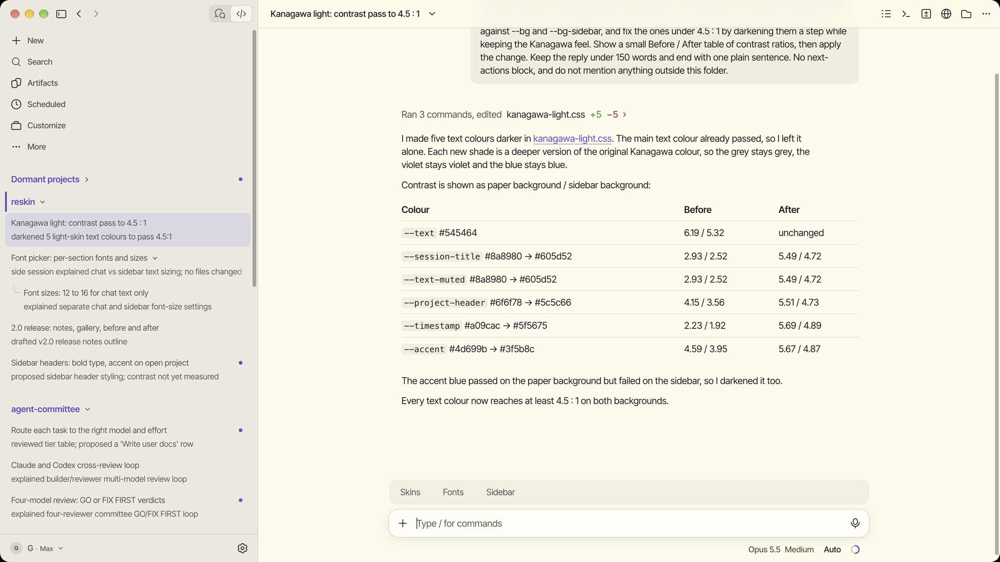

**Unofficial, just for fun, use at your own risk.** Reskin is not made, checked or endorsed by Anthropic. "Claude" is a
trademark of Anthropic, PBC. Reskin changes colours and, only if you turn them on, fonts and the sidebar's project
headers, through Claude's own Developer menu, and it may stop working after a Claude update. Read [SECURITY.md](SECURITY.md) before the first run: the one step it needs opens a debugger on
your Mac for a moment. Full notice: [NOTICE.md](NOTICE.md).

Reskin sends nothing off this Mac and does not touch your chats. Undo colours with `/skin off`, project headers with
`/skin type off` and fonts with `/skin font off`; `/skin remove` takes off all three and stops the helper. Quitting
Claude also takes off the colours, fonts and project headers and stops the helper. The band is separate: if it is on,
it comes back in new sessions until you type `/skin band off`. To uninstall, see
[Remove it completely](#remove-it-completely).

AI agents: read [`skin/skin-tool/AGENTS.md`](skin/skin-tool/AGENTS.md) before you run anything, and ask the user before
every `tick`.

## How it started

Reskin began as colour skins, sparked by a theme that gives OpenAI's Codex a Claude-style look (see Credits below).
What turned it into this was the project headers in the Code tab's sidebar: they were so small that I struggled to
read them. Making them bigger led to fonts, fonts led to sizes and weights, and typing a command for every change got
old, so the band came last. I am not a developer: Reskin is built with AI coding tools, mostly Claude Code, and each
release is tried by hand on a real Mac before it ships. 2.0 is where that ended up: the whole look, not just colours.

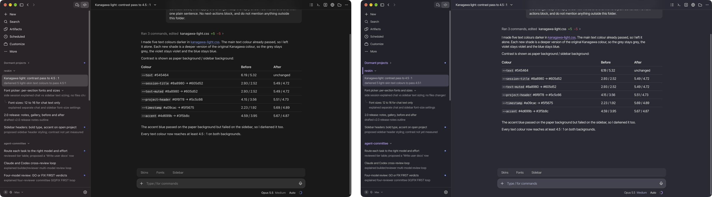

*Left: Claude's own colours and fonts. Right: Dracula with Inter Tight and the bigger project headers.*

## The skins

Each picture: the dark half on the left, the light half on the right. Real screenshots of the Claude desktop app
with each skin on. Each also shows one of the nine fonts, named beside the skin: fonts are chosen separately and do
not come with a skin. All of them were taken in the Code tab of the Claude desktop app, with the sidebar sections open.

| | |
|---|---|
| **absolutely**, shown with Inter Tight<br>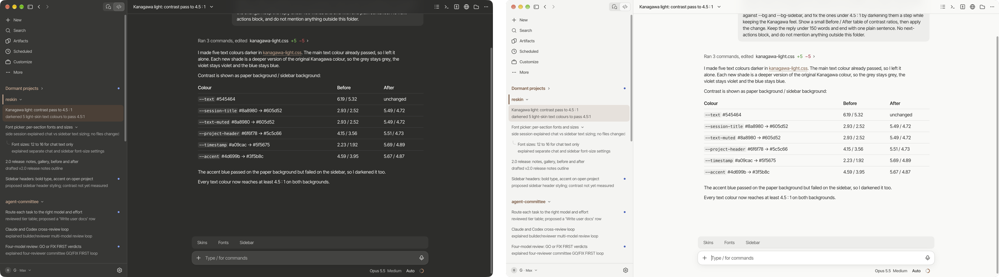 | **ayu**, shown with Commissioner<br>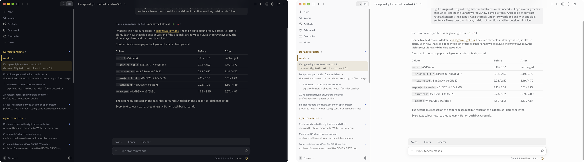 |
| **catppuccin**, shown with Zen Maru Gothic<br>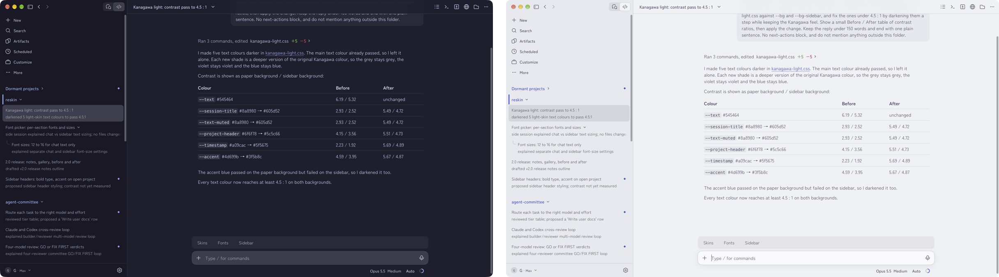 | **classic**, shown with Literata<br>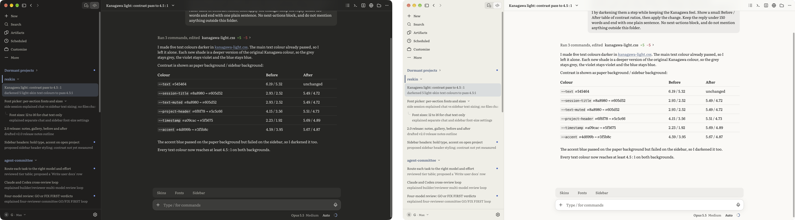 |
| **dracula**, shown with Inter Tight<br>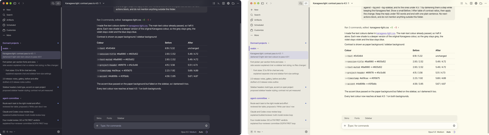 | **github**, shown with Roboto<br>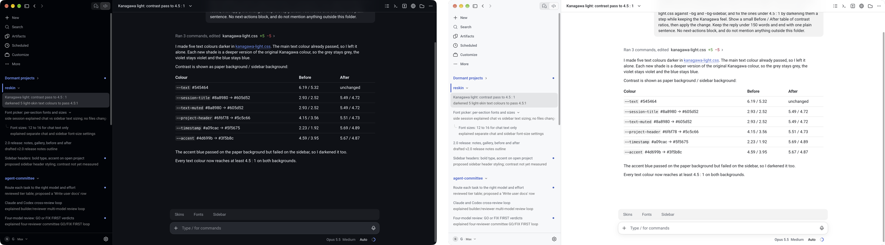 |
| **gruvbox**, shown with Lato<br>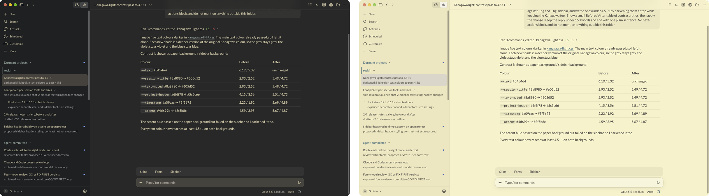 | **kanagawa**, shown with JetBrains Mono<br>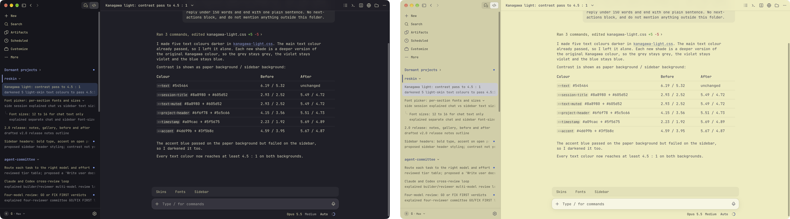 |
| **linea**, shown with IBM Plex Sans<br>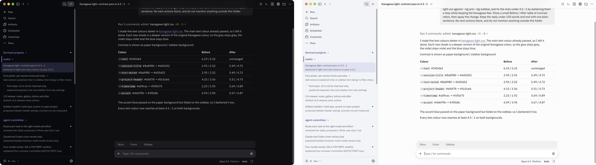 | **night-owl**, shown with JetBrains Mono<br>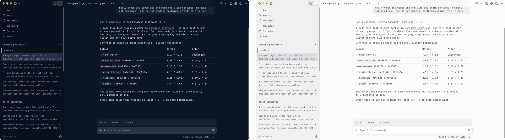 |
| **nord**, shown with IBM Plex Sans<br>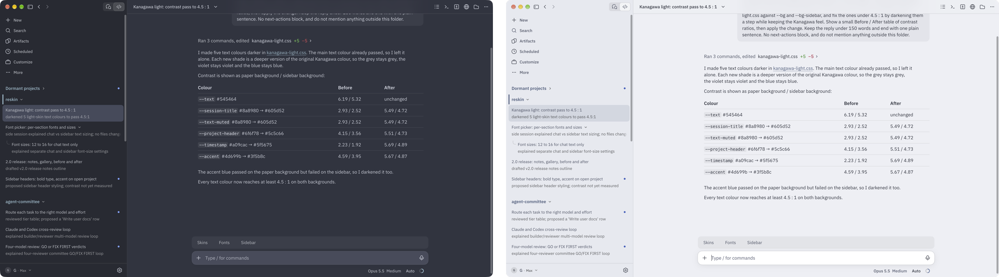 | **one**, shown with Lato<br>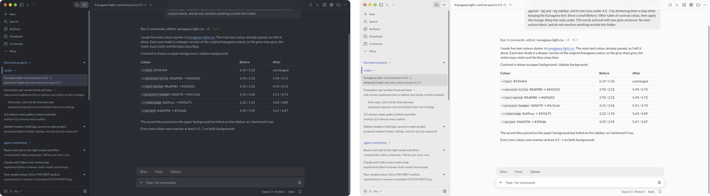 |
| **rose-pine**, shown with Literata<br>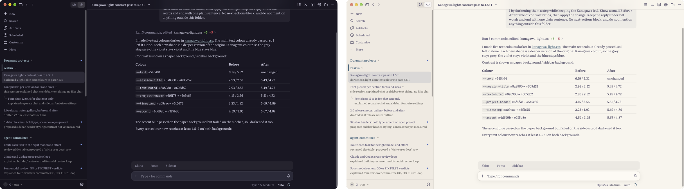 | **solarized**, shown with Noto Sans<br>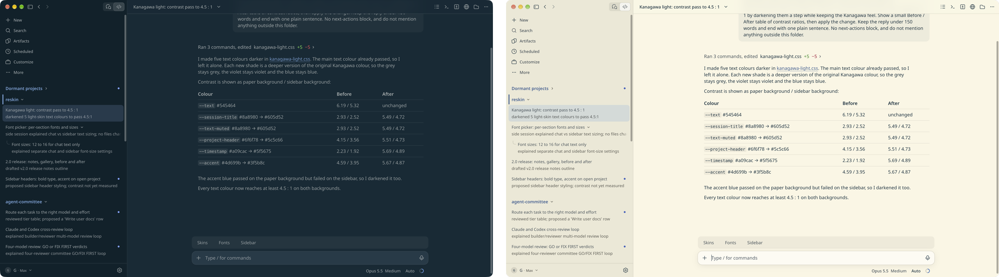 |
| **tokyo-night**, shown with Commissioner<br>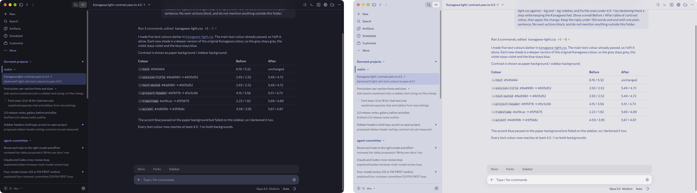 | **vs**, shown with Roboto<br>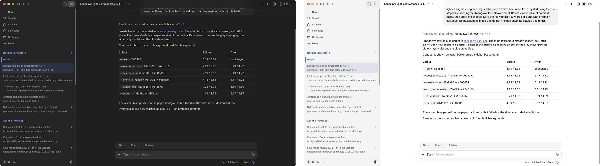 |

**The white family.** Seven light halves are near-white, because their source themes really are: github, vs, linea,
one, night-owl, ayu and absolutely. Switching between two of them changes the window only a little. The band's Skins
row confirms your choice with "✓ Now on: &lt;skin&gt;" and six colour squares. For a light look that is clearly different,
try catppuccin, gruvbox, kanagawa, rose-pine, solarized or tokyo-night.

The session status dots in the sidebar use the same colours in every skin, one set for dark and one for light, so a dot
always means the same thing: blue unread, orange waiting for you, red error, grey running. Where each colour comes from:
[`ATTRIBUTION.md`](skin/skin-tool/ATTRIBUTION.md).

## What you need

| Need | Why |
|---|---|
| A Mac with the Claude desktop app in `/Applications` | Reskin recolours that app only (not Windows, not Linux, not the claude.ai website), and checks Claude's signature at `/Applications/Claude.app`. |
| Claude Code, to get the `/skin` command | Reskin ships as a Claude Code plugin. It has been used from the desktop app's Code tab. |
| Node 22 or newer | The tool is a Node script and refuses older Node. |
| Developer Mode on in Claude (first time only) | The menu item Reskin needs only exists in Developer Mode. In Claude choose Help > Troubleshooting > Enable Developer Mode, then Enable in the message that follows. Claude restarts, and a Developer menu appears. |

No Accessibility permission, no network and no change to Claude's files.

## Install

Run these two lines in Terminal (they need Claude Code's `claude` command):

```
claude plugin marketplace add gregts/reskin-for-claude
claude plugin install skin@reskin-for-claude
```

Then type `/reload-plugins` in a Code tab session of the Claude desktop app, or restart Claude. Every `/skin` command
is typed there, in the Code tab (not in a normal chat).

If you also use hellosverre's [claude-skins](https://github.com/hellosverre/claude-skins) (it restyles Claude Code's
chat drawing, not the whole app), note that both plugins use the `/skin` command and only one can have it: whichever loads
second loses its `/skin` (if Reskin is the one that loses, it shows a status line saying so). Keep one of them enabled at a time.

## Update

Run these two lines in Terminal:

```
claude plugin marketplace update reskin-for-claude
claude plugin update skin@reskin-for-claude
```

Then quit Claude completely (Cmd+Q) and open it again, even if Reskin does not ask you to. This is needed after every
update: the colour helper inside Claude may have changed, and Reskin refuses an older one until Claude restarts.

In a Code tab session, type `/skin <name>` to apply a skin again. If you use fonts or project headers without a skin,
type `/skin fonts --tick` or `/skin type on --tick` instead. Wait for the card before you click **Developer > Enable
Main Process Debugger**. The project headers and fonts you had come back in that same run; the report says if one
could not.

## Use

1. Type `/skin list` to see the skins.
2. Type `/skin nord` (or another skin name). Wait for the card, then click **Developer > Enable Main Process
   Debugger** once in Claude's top menu bar, within 60 seconds and only while the card is asking. Do not click before
   the card appears or after the run ends. If you clicked late, or the item was already ticked before you started,
   quit Claude completely (Cmd+Q) and reopen it before trying again.
3. After your click, Reskin paints the colours, closes the debugger again and reports what it checked. This is the
   only step that opens anything.
   - With Google Chrome installed, Claude opens a `chrome://inspect` tab in it. Close that tab.
   - Without Google Chrome, Claude shows a message "Inspector session is active" and freezes until you click OK. Click OK.
4. Later switches need no click: `/skin dracula`, `/skin off`. A small colour helper stays inside Claude until Claude
   quits. After Claude quits, its own colours return; starting the helper again needs one click, whether you start
   with a skin, fonts or project headers.

### The appearance band (optional, off until you turn it on)

`/skin band on` adds a quiet line above the message box with three words: **Skins**, **Fonts** and **Sidebar**. Press
one to open its row underneath (one row at a time); press it again, or the ✕ at the right, to close it. `/skin band off`
hides the band. It stays on or off for every session until you change it; a new chat shows it once its session starts.

- **Skins**: pick a skin (or Claude's own colours) and press Apply. When Reskin has read back that the skin is on, the
  row says "✓ Now on: &lt;skin&gt;" with six small colour squares: the light page, sidebar and accent, then the dark ones.
  (A skin switched by typing clears that line.) Reset puts Claude's own colours back (the helper stays, so the next skin needs no click).
- **Fonts**: the same row as `/skin fonts`.
- **Sidebar**: the project headers on or off (`/skin type on` / `/skin type off`), with Apply.
- The band's buttons go through the colour helper only and never tick anything by themselves. With no helper yet, a
  row offers **Set up with one tick…**, which opens the usual card. Wait for that card, then click **Developer > Enable
  Main Process Debugger** once.

Other commands: `/skin status` shows the current setup, `/skin check` checks that the skin still shows its own
colours, `/skin log` shows the last five runs, and `/skin about` explains Reskin. `/skin remove` takes off the colours,
fonts and project headers and stops the helper. Project headers (`/skin type on`) and fonts (`/skin fonts`) are
described next.

### Project headers with activity colours (optional, off until you turn it on)

`/skin type on` sets the Code tab sidebar's project headers to 14px. Quiet projects use the main text colour. A
project with a session that is running, waiting for you or unread uses the skin's accent colour, a little heavier,
whether the project is folded or open. The project holding the chat you are in also uses the accent, with a thin
accent stripe at the left of its header. The shared sidebar row text size becomes 13px. These changes use the skin's
colours, or Claude's own colours when no skin is on, and work in light and dark mode.

- It needs the colour helper. With no helper yet, `/skin type on --tick` starts it with one click and puts no skin on
  (Claude keeps its own colours); or apply a skin first. After that, `type on` and `type off` need no click.
- `/skin off` leaves the project headers on; `/skin type off` takes them off; `/skin remove` takes off both.
- Folded projects keep their colours: Claude keeps a folded project's sessions in the page, just hidden.
- The session-name size is a shared sidebar size, so a few other small sidebar texts become 13px too.
- After Claude quits, `/skin status` reminds you; `/skin type on --tick` brings it back with no skin, or the next skin
  brings it back by itself.
- Turning project headers off may reload Claude's pages if Reskin cannot confirm that the change was removed. Your
  colour skin stays on.

### Fonts (optional, off until you choose one)

`/skin fonts` opens a row above the message box. Choose a part and a font, then press Apply. Chat text, Sidebar rows
and Project headers also offer a size and a weight (how light or bold the letters look); All parts and Everything else
offer a font only.

| Part | What it changes |
|---|---|
| All parts | One font throughout the app; each part keeps its own size and weight |
| Chat text | Claude's replies, the questions you have sent, and the message box |
| Sidebar rows | Session names and other sidebar row text |
| Project headers | Project names in the Code tab sidebar |
| Everything else | Menus, buttons and settings; also the font of any part without its own font choice |

**Reset depends on the part you picked:**

- For Chat text, Sidebar rows or Project headers, Reset removes that part's font, size and weight choices. Its font
  then follows Everything else, which is Claude's own font unless you chose one there.
- For Everything else, Reset puts Claude's own font back as the shared font and keeps the other parts' own choices.
- For All parts, Reset removes every font choice but keeps each part's size and weight.
- To clear every font, size and weight choice, type `/skin font off`.

None of these turns off the separate project headers feature (`/skin type on`): its 14px headers and 13px session
names stay until `/skin type off`.

You can also type `/skin font plex 16` (IBM Plex Sans throughout the app, chat text at 16px) or `/skin font list` (the
fonts, whether each is installed, and where to download it).

- Nine free fonts (SIL Open Font License, as distributed by Google Fonts): Inter Tight, Literata, IBM Plex Sans, Noto Sans, Roboto, Lato, Zen Maru
  Gothic, Commissioner and JetBrains Mono. Reskin ships names only, never font files: install a font first (`/skin font
  list` has the links); Reskin checks that it is installed before it uses it.
- Sizes: chat text 12 to 16 px, sidebar rows 12 to 15 px, project headers 12 to 16 px. Weights: chat text and sidebar
  rows 300, 400 or 500; project headers 400, 500 or 600; only weights the chosen font has. All parts and Everything
  else choose a font only. Bold stays bold. Code keeps its own font; code and some icons may follow a weight.
- It needs the colour helper. With no helper yet, `/skin fonts --tick` (or `/skin font plex 14 --tick`, or
  `/skin font plex type on --tick`) starts it with one click and puts no skin on; or apply a skin first. After that,
  fonts need no click.
- While a Reskin font is on, Claude's own font menu has no effect on the text using it. While a Reskin chat size is on,
  Claude's Transcript text size has no effect on chat text.
- `/skin check` says, per part, whether the font, size and weight on screen match. `/skin font off` or `/skin remove`
  takes the fonts off; `/skin off` keeps them.
- Closing the row hides its controls; the fonts, sizes and weights you applied stay on. Type `/skin fonts` to reopen
  it, or `/skin font off` to clear those choices.

### Fonts and headers with no skin (one click)

`/skin type on --tick`, `/skin font <name> [size] --tick`, `/skin font <name> type on --tick` and `/skin fonts --tick`
start the colour helper with one click on **Developer > Enable Main Process Debugger** and put no skin on. Before you
click, the card says what will happen: any Reskin skin is taken off, a Claude page may reload once, and the headers and
fonts you had last time come back too (listed by name, size and weight). After the click the helper takes any skin off,
checks that no skin is on, then sets each part in turn and stops at the first one that does not work (the answer says
what is on). If a colour helper is already running, these commands say no click is needed: use them without `--tick`.
`/skin type off --tick` and `/skin font off --tick` are refused (with no helper there is nothing to turn off), and
`/skin off --tick` still takes the skin and the helper away.

The desktop app does not show a typeahead list of skin names after `/skin`. Use `/skin list` instead.

After a Claude update, run `/skin check` once: it checks sampled colours and reports missing page structures.

### Without the plugin

From the `skin/skin-tool` folder of a copy of this repo:

```
node skin-auto.mjs --check
node skin-auto.mjs tick nord
node skin-auto.mjs switch dracula
node skin-auto.mjs status
node skin-auto.mjs check
```

`--check` is read-only and lists what this Mac still needs. With no helper running, `tick <name>` applies a skin and
starts the helper: click **Developer > Enable Main Process Debugger** within 60 seconds. `tick off [--want-font=<name>] [--want-type=on]`
starts the colour helper with no skin (the same click). After that, `switch` takes a skin name, `off` or
`remove`, with no click.

### Raycast

`skin/skin-tool/raycast/` holds two Raycast script commands. They only switch skins through the colour helper, so run
`/skin <name>` in Claude once first. Without a helper they say so and do nothing. Their "Remove skin" choice also ends
the helper (like `/skin remove`), so after it the next skin needs `/skin <name>` in Claude again.

## What it never does

- It never patches Claude's files and never changes Claude's settings, including Appearance.
- It never clicks the Developer menu item by itself and never applies a skin at login or when Claude restarts.
- It never sends anything off this Mac: its only connections are to Claude on 127.0.0.1.
- It applies only its own 16 colour skins, one optional type sheet and optional fonts. Skins change colours only. The type sheet sets
  project headers to 14px at weight 400 or 500, in the main text colour or the accent colour, draws one thin accent
  stripe beside the open chat's project, and sets the shared sidebar row text size to 13px, which can affect session
  names and other sidebar text. Fonts set the family, size and weight of chosen parts, from fixed tables of nine
  fonts, sizes and weights; no font file is loaded. Nothing is hidden or renamed.
- It never takes screenshots in normal use.

## Remove it completely

To stop using Reskin but keep it installed, type `/skin band off`, then quit Claude completely (Cmd+Q). To uninstall it:

1. Quit Claude completely (Cmd+Q). That removes the colours, the fonts, the headers, the helper and any open debugger.
2. In Terminal, run `claude plugin uninstall skin@reskin-for-claude`, then open Claude again.
3. Optional: turn Developer Mode off again from Claude's Help menu, if you do not use it for anything else.
4. Optional: delete Reskin's own folders, `~/Library/Application Support/claude-skin/` (helper files and the last skin
   name) and `~/Library/Logs/Reskin/` (the log).

## If something goes wrong

- Click **Developer > Enable Main Process Debugger** only while a Reskin card or run asks you to. After the run, never
  click it again: a click then opens the debugger with nothing watching it. Near the end of a click run, if enough
  time is left, Reskin waits 5 seconds and looks at the closed debugger once more; if it finds it open again, it warns
  you, tries to close it and checks the result. This is a single extra look, not a watch after the run ends: if you
  clicked later, quit and reopen Claude.
- If a run warns that the Developer menu item may still show a tick, do not click it (a click opens the debugger
  again). Quit and reopen Claude instead.
- `lsof -nP -iTCP:9229 -sTCP:LISTEN` prints nothing when the debugger is closed.
- `/skin log` shows the last five runs. The full log is `~/Library/Logs/Reskin/skin.log`. Known secret formats are
  removed from it, but that is a filter, not a guarantee: read an entry before you share it.
- `/skin check` reports `FAIL` or `structure changed` when a Claude update changed what Reskin paints, with a `Repair:`
  line.
- Exit codes of `skin-auto.mjs`: 0 ok, 1 failed, 2 usage, 3 port not confirmed closed (quit and reopen Claude), 4 took
  too long, 5 refused before changing anything, 6 a throwaway Chrome could not be confirmed ended, 130 interrupted.
- Report a bug with the issue form. Report a security problem privately: see [SECURITY.md](SECURITY.md).

Reskin is a hobby project. When a Claude update breaks it, fixing that comes first; everything else is best effort.

## Tested with

Only what was run by hand on a real Mac is listed. Everything else is untested. Older rows record colour checks on
earlier builds; they do not establish type compatibility. Type checks are listed explicitly.

| Claude desktop | Mac | macOS | Chrome | Node | What ran | Result |
|---|---|---|---|---|---|---|
| 5.11492.2 | MacBook Air 13-inch, M3 | 27.2 | not installed | 26.13.0 | the public 2.0.0 install from this repo (Nord): `check` in dark and in light with colours, project headers, every font, size and weight line and the sent-prompt line matching; the colour helper was already running, so no debugger was used | passed |
| 5.1231.0 | MacBook Air 13-inch, M3 | 27.2 | not installed | 26.13.0 | the public 2.0.0 install from this repo (final package; Dracula): plugin switched from a development copy, `tick`, `check` in dark with colours, project headers, every font, size and weight line and the sent-prompt line matching; debugger confirmed closed, still closed 5 s later; light half not checked | passed (dark) |
| 4.23118.1 | MacBook Pro 14-inch, M4 Pro | 27.2 | not running | 26.10.0 | the public 2.0.0 install from this repo (Dracula): `check` in dark with colours, project headers, every font, size and weight line and the sent-prompt line matching; the colour helper was already running, so no debugger was used; light half not checked | passed (dark) |
| 4.23118.0 | MacBook Air 13-inch, M3 | 27.2 | not installed | 26.13.0 | a development copy of this release (not from this repo; before the see-through-box fix and the second look): `tick` (door open 1.8 s, then closed), `check` in dark and light, the band (Skins, Fonts, Sidebar) by eye including a narrow window, kanagawa, `/skin verc` refused | passed |
| 4.16336.0 | MacBook Pro 14-inch, M4 Pro | 27.2 | not running | 26.10.0 | an earlier development copy of this release (not from this repo; before the two new fonts, the sent-prompt fonts, the second look and the health check's skipping of see-through boxes): the band (`tick kanagawa` from its setup button with the fonts coming back, Skins Apply with the "Now on" line, Fonts, Sidebar), kanagawa seen in dark and light, `/skin verc` refused; earlier development copies: `tick` with type on, the `/skin fonts` row (all parts set: chat text, sidebar rows, project headers, everything else), `check` in dark with every font, size and weight line matching | passed |
| 4.4212.0 | MacBook Pro 14-inch, M4 Pro | 27.2 | installed, not running | 26.10.0 | the 1.1.0 build (from a development copy, not from this repo): `tick`, `check` in light; type: `/skin type on` and `/skin type off`, bold headers seen by eye with Dracula and with no skin (no skin in dark and light), `type: on when last set` after a restart | passed |
| 4.29.0 | MacBook Pro 14-inch, M4 Pro | 27.2 | installed | 26.10.0 | the public 1.0.0 install from this repo: `tick`, `check` in dark and light | passed |
| 3.6556.1 | MacBook Pro 14-inch, M4 Pro | 27.0.1 | installed, not running (Chrome started by the click) | 26.10.0 | an earlier build (from a development copy, not from this repo): `tick`, `check` in dark and light | passed |
| 2.42304.2 | MacBook Pro 14-inch, M4 Pro | 27.0.1 | installed | 26.10.0 | an earlier build (from a development copy, not from this repo): `tick`, `check` in dark and light | passed |
| 2.42304.0 | MacBook Pro 14-inch, M4 Pro | 27.0.1 | installed | 26.10.0 | an earlier build (from a development copy, not from this repo): `tick`, `switch`, `check`; with the build before it, all 16 skins seen in dark and light | passed |
| 2.42304.0 | MacBook Air 13-inch, M3 | 27.0.1 | not installed | 26.7.0 | `tick` and `switch` with an earlier build and the earlier skin set | passed |

Untested: any other Claude version, Intel Macs, macOS before 27, menus in a
language other than English. Claude's internal page structure changes often; `/skin check` exists to notice when an update
breaks a skin, and `skin/skin-tool/tested-versions.json` lists the Claude versions the skins were seen working on.

## Known limits

| Limit | What you get instead | Where | Test |
|---|---|---|---|
| A Claude update can break the skins at any time | `/skin check` says `FAIL` or `structure changed`; the report names Claude's version and says when it is not one of the tested ones | `judgeHealth` in `skin-lib.mjs` | `health-check.test.mjs` |
| After a run, only five colours are sampled | "sampled colour checks: N of M passed (U unknown)". Unreadable samples count as unknown, never as a pass | `judgeChecks` in `skin-lib.mjs` | `two-choice.test.mjs`: "sampled colour checks: real presets, ..." |
| Hover colours as painted and pop-up menus are not checked by the tool (`/skin check` reads only the hover colour's token value) | Look at them | none | none |
| Some blue stays Claude's blue: named blues, charts, tinted tags, the drag-and-drop highlight | Left alone on purpose | accent rules in `make-presets.mjs` | `accent.test.mjs`: "named blues, clay, charts and tint colours are left alone" |
| The helper ends when Claude quits | `/skin status` offers to reapply the last skin, which needs one click | `liveSession` in `skin-lib.mjs` | `two-choice.test.mjs`: "client: liveSession is active only for the very Claude process ..." |
| Any program running as you can command the helper or fake its answers | `/skin` talks to the helper through files in your user folder, so another program running as you could change them; quitting Claude always ends the helper | colour helper in `skin.mjs` | `security.test.mjs`: "a removal through the helper is reported ..." |
| Without Chrome, Claude is frozen and the debugger stays open until you click OK on its message | The card tells you to click OK; no timer can run sooner. The skin step waits for Claude (`PATIENT_MS` in `skin.mjs`) | `tickRun` in `skin-auto.mjs` | `shorter-door.test.mjs` |
| The project headers rely on Claude's sidebar structure, which can change | `/skin check` reports matching header counts when available. No matches may mean there are no project headers or Claude's sidebar changed. The check does not verify the headers' actual size, weight or colour; look at them. `/skin type off` removes the type changes | `typeLine` in `skin-lib.mjs` | `type-slot.test.mjs`: "typeLine: the check reports what the pages show" |
| The current-project highlight (accent and left stripe) needs the open chat's row in the page | Claude keeps a folded project's rows in the page, so it normally stays; if Claude ever stops doing that, the header shows the main text colour until the project is opened | `type/sidebar-headers.css` | none (seen live) |
| The Developer menu item is found by its English name | If it cannot be found to clear the tick, the run says so | `UNTICK` in `skin.mjs` | `security.test.mjs`: "UNTICK clears the tick without clicking ..." |
| If the debugger cannot be confirmed closed, Reskin stops | Quit and reopen Claude | guardian in `skin-lib.mjs` | `skin-tool.test.mjs`: "the guardian: closes on unknown or open, ..." |
| Near the end of a click run (when enough time is left), the debugger is looked at once more after a 5 s wait; that look can be skipped when time is short, and a click on the menu item after the run ends is not noticed | Never click the item after a run; if you did, quit and reopen Claude | `secondLook` in `skin-lib.mjs`, `doCleanup` in `skin-auto.mjs` | `shorter-door.test.mjs`: "cleanup: the second look runs for tick runs that saw the port, ..." and "secondLook: skipped ..." |
| `/skin check` skips the small boxes Claude itself keeps see-through (exactly `!bg-transparent` or `bg-transparent!`), because no skin can colour them | Those boxes keep Claude's look. Other eligible boxes can still be sampled, and a sampled wrong colour fails; the check does not inspect every box | `FORCED` in `skin.mjs` | `health-check.test.mjs`: "judge: a raised panel that is read and shows the wrong colour fails ..." |
| Running `skin.mjs` directly has no guardian and no run lock | For developers only; use `skin-auto.mjs` or `/skin` | `skin.mjs` | none |
| Memory and CPU cost was measured by hand on one Mac (M4 Pro), one long chat and test pages; not on 8 GB Macs, many windows at once or days of use | Measured on real Claude: window memory within a few MB of no skin, and no extra CPU at rest. Each skin switch used about 0.1 to 0.15 s of CPU on a very long chat (once 0.57 s). On test pages only: streaming text cost the same with or without a skin, and a Light/Dark switch cost a little more on ordinary test pages, but about 2.5 times as much on a worst-case test page (0.2 s against 0.08 s). Scrolling and the helper's own idle cost were not measured. The helper checks its folder once a second while Claude runs, even with colours off; `/skin remove` stops it | colours set on every page element (`*` rule) in `make-presets.mjs` | none |
| The log filter removes known secret formats only | Read an entry before you share it | `skin-log.mjs` | `run-log.test.mjs`: "redaction: every known format ..." |

Test files are in `skin/skin-tool/tests/` (`node --test --test-concurrency=1 'tests/*.test.mjs'`, about 2 minutes) and
`skin/tests/` (`claude plugin test skin`).

## Credits and licence

Reskin is MIT licensed ([LICENSE](LICENSE)). Every colour scheme belongs to its authors: sources in
[`ATTRIBUTION.md`](skin/skin-tool/ATTRIBUTION.md), their licence texts in
[THIRD-PARTY-NOTICES.md](THIRD-PARTY-NOTICES.md).

Thanks to [miniLV/Anthropic-codex-theme](https://github.com/miniLV/Anthropic-codex-theme), which gives OpenAI's Codex
a Claude-style look. It sparked the idea of going the other way: colour skins for Claude. Reskin uses none of its code
or colours.
